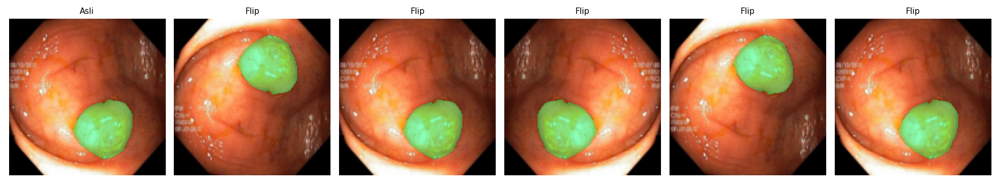
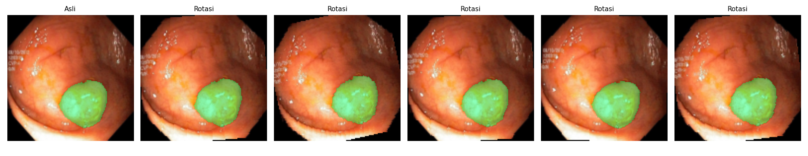
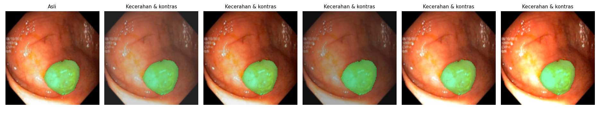
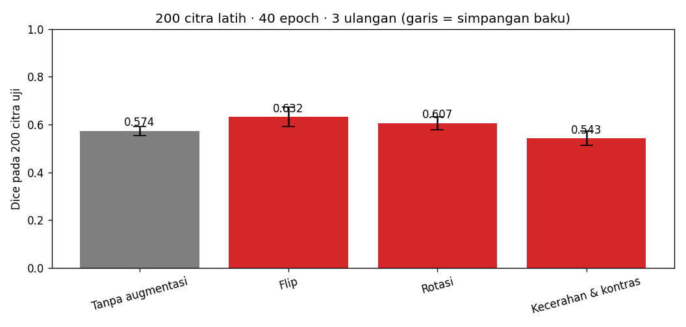
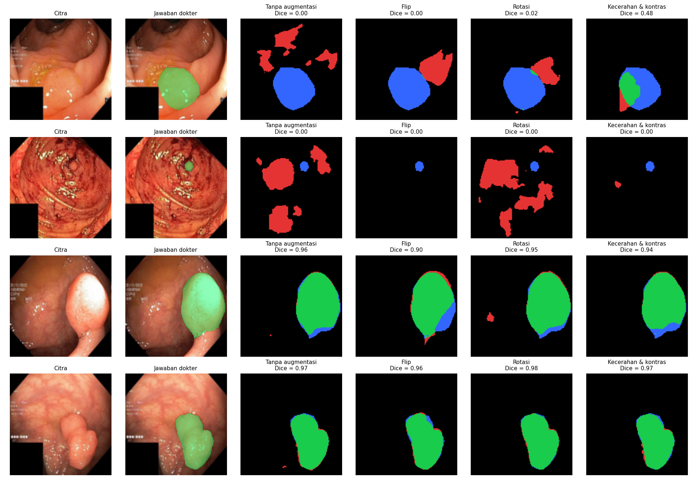

# Segmentasi Polip pada Citra Kolonoskopi dengan U-Net

<!--
  TEMPLATE LAPORAN — Tugas P10 Kecerdasan Buatan (BM25-41204), Teknik Biomedis ITERA.
  Petunjuk lengkap: https://mctm.web.id/ai-bm/tugas

  Cara memakai:
  - Ganti semua teks yang diawali "✍️" dengan tulisan kelompokmu, lalu hapus tanda ✍️-nya.
  - Blok komentar seperti ini adalah petunjuk; tidak tampil di GitHub. Boleh dihapus.
  - Gambar diambil dari folder hasil/ yang dibuat otomatis oleh notebook.
  - Jangan hapus judul-judul bagian (##).
-->

**Tugas P10 — Kecerdasan Buatan (BM25-41204), Teknik Biomedis ITERA**

## Anggota kelompok

| Nama | NIM | Username GitHub | Kontribusi utama |
|---|---|---|---|
| Caroline Chelsea Putri | 123430069 | caroline123430069 | Implementasi dan pelaksanaan eksperimen |
| Aprillia Cindy | 123430077 | aprillia123430077-ux | Penyusunan skenario, hipotesis, dan laporan |
| Ulfa Annisa | 123430081 | ulfa123430081-oss | Analisis hasil dan penyusunan laporan |

## 1. Pertanyaan

Augmentasi apa yang membantu U-Net menemukan polip pada citra kolonoskopi, dan augmentasi apa yang tidak? Kenapa?

## 2. Data & pengaturan

<!-- Isi dari Bagian 2 notebook. Pastikan CEPAT = False untuk hasil akhir. -->

- Dataset: Kvasir-SEG (1000 citra kolonoskopi dan mask polip), diperkecil ke 128 × 128 piksel.
- Data uji: 200 citra (tetap). Data latih: 200 citra per ulangan.
- Model: U-Net Mini (±0,5 juta parameter), 40 epoch, 3 ulangan per skenario.
- Dijalankan di: Google Colab dengan GPU NVIDIA Tesla T4.


## 3. Skenario augmentasi & hipotesis

<!-- Tulis bagian ini SEBELUM menjalankan eksperimen. Commit dulu, baru jalankan.
     Alasan klinis = kenapa variasi ini mungkin (atau tidak mungkin) terjadi pada kolonoskopi sungguhan. -->

| Skenario | Augmentasi (kode) | Alasan klinis | Hipotesis: Dice naik/turun/sama? |
|---|---|---|---|
| Tanpa augmentasi | — | Pembanding | — |
| Flip | v2.RandomHorizontalFlip() dan v2.RandomVerticalFlip() | Orientasi citra kolonoskopi dapat bervariasi akibat pergerakan dan posisi kamera endoskop. | Dice diperkirakan naik. |
| Rotasi | v2.RandomRotation(degrees=15) | Sudut pengambilan citra dapat berubah mengikuti arah pergerakan endoskop. | Dice diperkirakan naik. |
| Kecerahan & Kontras | v2.ColorJitter(brightness=0.3, contrast=0.3) | Intensitas pencahayaan dan kontras dapat bervariasi selama pemeriksaan kolonoskopi. | Dice diperkirakan naik. |
| Hue (Rona Warna) | v2.ColorJitter(hue=0.1) | Warna kemerahan tidak aman untuk diubah, supaya sistem bisa dengan mudah mendeteksi polip yang berwarna kemerahan sehingga hue tidak perlu diubah. | Dice diperkirakan sama. |

Contoh augmentasi yang dicoba:







## 4. Hasil

Eksperimen dilakukan menggunakan 200 citra latih, 40 epoch, dan 3 ulangan untuk setiap skenario. Evaluasi dilakukan menggunakan metrik Dice dan Intersection over Union (IoU).

| Skenario | Dice (rata-rata ± sb) | IoU (rata-rata ± sb) | Dice tiap ulangan |
|---|---|---|---|
| Tanpa augmentasi | 0.574 ± 0.019 | 0.461 ± 0.026 | 0.547, 0.588, 0.586 |
| Flip | **0.632 ± 0.041** | **0.527 ± 0.037** | 0.582, 0.631, 0.682 |
| Rotasi | 0.607 ± 0.027 | 0.495 ± 0.020 | 0.601, 0.641, 0.577 |
| Kecerahan & kontras | 0.543 ± 0.030 | 0.434 ± 0.029 | 0.583, 0.537, 0.510 |



Berdasarkan hasil evaluasi eksperimen menggunakan 200 citra latih, 40 epoch, dan 3 ulangan, performa model U-Net Mini menunjukkan variasi yang signifikan di setiap skenario augmentasi. Berdasarkan metrik Dice dan Intersection over Union (IoU), skenario Balik (Flip) mencatatkan performa tertinggi dengan rata-rata skor Dice sebesar 0,632 ± 0,041 dan IoU 0,527 ± 0,037, disusul oleh skenario Rotasi pada posisi kedua dengan rata-rata Dice 0,607 ± 0,027. Sebaliknya, model baseline (Tanpa tambahan) memperoleh rata-rata Dice 0,574 ± 0,019, sedangkan skenario Kecerahan & kontras mencatatkan hasil terendah yaitu 0,543 ± 0,030 yang berada di bawah performa tanpa augmentasi.

Peningkatan skor pada skenario Flip dan Rotasi menunjukkan bahwa variasi orientasi spasial efektif membantu model mempelajari morfologi polip dari sudut pandang endoskop yang dinamis. Sebaliknya, penurunan performa pada skenario Kecerahan & kontras mengindikasikan bahwa manipulasi pencahayaan secara acak berpotensi mendistorsi detail tekstur dan batas mukosa usus, sehingga tidak mendukung peningkatan akurasi segmentasi. Selain itu, garis simpangan baku pada diagram batang dan variasi nilai pada tiap ulangan mencerminkan fluktuasi kestabilan pelatihan yang memerlukan optimasi lanjutan.

## 5. Analisis peta kesalahan



<!-- Hijau = benar, merah = false positive, biru = false negative.
     Pertanyaan pemandu: Polip seperti apa yang sering terlewat (kecil? datar? warna mirip dinding usus?)
     Apa yang sering dikira polip padahal bukan? Apakah augmentasi memperbaiki kasus sulit? -->

Peta kesalahan menunjukkan hasil segmentasi model pada citra uji. Warna hijau menunjukkan True Positive (TP), merah menunjukkan False Positive (FP), dan biru menunjukkan False Negative (FN).

Pada citra uji yang sulit, beberapa skenario masih mengalami kesalahan segmentasi. Pada contoh pertama, Kecerahan & kontras memperoleh Dice 0.48, sedangkan Tanpa augmentasi dan Flip memperoleh Dice 0.00. Rotasi memperoleh Dice 0.02.

Pada contoh kedua, seluruh skenario memperoleh Dice 0.00. Hal ini menunjukkan bahwa model masih kesulitan melakukan segmentasi pada beberapa karakteristik polip.

Pada citra yang lebih mudah, seluruh skenario menunjukkan hasil segmentasi yang lebih baik dengan Dice sekitar 0.90–0.98.

## 6. Pembahasan & kesimpulan

<!-- Bandingkan hasil dengan hipotesis di Bagian 3. Hipotesis yang ternyata salah tetap bernilai,
     asalkan dijelaskan kenapa. Perbedaan kecil (lebih kecil dari simpangan baku) belum tentu berarti. -->

Hasil eksperimen menunjukkan bahwa augmentasi Flip memperoleh performa terbaik dengan rata-rata Dice 0.632 dan IoU 0.527. Rotasi menempati urutan kedua dengan Dice 0.607 dan IoU 0.495..

Skenario Flip dan Rotasi menunjukkan peningkatan performa dibandingkan tanpa augmentasi. Hasil ini mendukung hipotesis bahwa variasi orientasi citra dapat membantu model mempelajari karakteristik polip dari sudut pandang yang berbeda.

Sebaliknya, Kecerahan & kontras memperoleh Dice 0.543 dan IoU 0.434, lebih rendah dibandingkan baseline. Dengan demikian, hipotesis peningkatan performa melalui variasi pencahayaan tidak didukung oleh hasil eksperimen ini.

Kesimpulannya, pada konfigurasi penelitian ini, Flip merupakan augmentasi yang memberikan hasil segmentasi terbaik. Namun, beberapa citra masih menghasilkan kesalahan segmentasi sehingga diperlukan pengujian lebih lanjut untuk meningkatkan kemampuan generalisasi model.

## 7. Pembagian kerja

<!-- Siapa mengerjakan apa. Penilaian proses kerja dilihat dari riwayat commit tiap anggota. -->

| Nama | NIM | Kontribusi utama |
|---|---|---|
| Caroline Chelsea Putri | 123430069 | Menentukan dan mengimplementasikan skenario augmentasi pada notebook Google Colab, mengatur parameter eksperimen, menjalankan pelatihan U-Net sebanyak 3 ulangan, serta mengumpulkan dan merekap hasil evaluasi Dice dan IoU. |
| Aprillia Cindy | 123430077 | Membantu menentukan skenario augmentasi, menyusun alasan klinis dan hipotesis setiap skenario, mendokumentasikan pengaturan eksperimen, serta menyusun bagian metode dan hasil pada README. |
| Ulfa Annisa | 123430081 | Membantu meninjau penerapan skenario augmentasi, menganalisis hasil perbandingan Dice dan IoU serta peta kesalahan segmentasi, dan menyusun bagian pembahasan, kesimpulan, serta dokumentasi akhir laporan. |

## 8. Penggunaan AI

<!-- Wajib diisi, walau tidak memakai AI (tulis "Tidak memakai AI").
     Contoh: "Claude Code (CLI) untuk menulis skenario augmentasi dan memperbaiki error di Bagian 4.
     Draf Bagian 6 ditulis sendiri, lalu dirapikan bahasanya dengan bantuan AI." -->

AI (ChatGPT) digunakan sebagai alat bantu dalam mendiskusikan skenario augmentasi, menyusun hipotesis dan alasan klinis, memahami hasil evaluasi Dice dan IoU, serta merapikan penulisan laporan. Seluruh pemilihan skenario, pelaksanaan eksperimen, pemeriksaan hasil, dan keputusan akhir dilakukan oleh anggota kelompok.

## Cara menjalankan ulang

```bash
uv sync
uv run jupyter lab segmentasi_polip.ipynb
```

Atau buka notebook di Google Colab (Runtime → Change runtime type → T4 GPU).

## Referensi

- Jha, D., dkk. (2020). Kvasir-SEG: A Segmented Polyp Dataset. *MultiMedia Modeling (MMM 2020)*, 451–462.
- Ronneberger, O., Fischer, P., & Brox, T. (2015). U-Net: Convolutional Networks for Biomedical Image Segmentation. *MICCAI*. arXiv:1505.04597.
- Sánchez-Peralta, L. F., Picón, A., Sánchez-Margallo, F. M., & Pagador, J. B. (2020). Unravelling the effect of data augmentation transformations in polyp segmentation. *International Journal of Computer Assisted Radiology and Surgery, 15*, 1975–1988. https://doi.org/10.1007/s11548-020-02262-4
